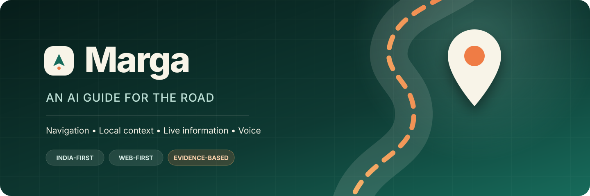
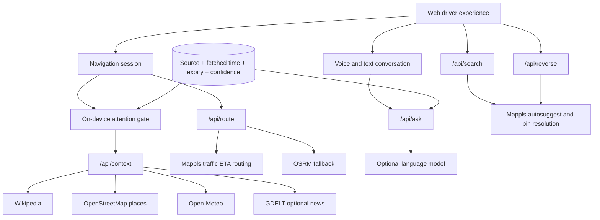

<p align="center">
  
</p>

<p align="center">
  <strong>Navigation that helps you understand the journey.</strong><br />
  India-first · Web-first · Voice-first · Evidence-grounded
</p>

<p align="center">
  <a href="#working-today">Features</a> ·
  <a href="#run-locally">Local setup</a> ·
  <a href="#architecture">Architecture</a> ·
  <a href="./ROADMAP.md">Roadmap</a> ·
  <a href="./ARCHITECTURE.md">Design notes</a>
</p>

## What is Marga?

Marga is an AI-powered navigation companion for Indian roads. It provides routes and turn guidance while deciding which nearby landmarks, places, weather conditions, and local facts are useful enough to mention. Drivers can ask natural questions such as “What is interesting ahead?”, “Will it rain?”, or “Find food nearby.”

The map remains the primary interface. Optional companion speech is filtered by distance, direction, driving context, user interests, freshness, confidence, repetition, and proximity to the next maneuver.

> **Development status:** Marga is being completed and tested locally before its next public deployment. The current public URL is an earlier prototype and does not represent this repository’s full working state.

## Working today

**Readiness correction:** the features below describe implemented pieces, not a verified complete trip. See [DELIVERY_GAPS.md](./DELIVERY_GAPS.md) for fixes already verified, remaining functions, and customer acceptance gates. Browser GPS tracking is implemented, while real-device movement and end-to-end navigation still require field validation.

| Area | Current implementation |
| --- | --- |
| Map | MapLibre with OpenFreeMap tiles and a clearly labelled placeholder if WebGL fails |
| Search | Mappls autosuggest with server-side credentials and provider-pin resolution through Place Details or a routed waypoint |
| Routing | Mappls traffic-adjusted driving ETA, geometry and maneuvers, with OSRM as an explicitly non-traffic fallback |
| Navigation | Route matching, progress, maneuver priority, off-route detection, and rerouting from the current position |
| Location | Browser GPS watch, GPS selection for either endpoint, exact dropped pins, and deterministic drive simulation |
| Context | Nearby Wikipedia landmarks, OpenStreetMap food places, Open-Meteo conditions, and optional GDELT local news |
| Attention | Interest scoring, route direction, freshness, confidence, cooldowns, maneuver suppression, and duplicate prevention |
| Conversation | Evidence-only fallback answers with optional OpenAI Responses API generation |
| Voice | Browser speech recognition and speech synthesis with six Indian language/locale choices |
| Personalization | Interests, talkativeness, voice preference, and language saved locally |
| Journey memory | Local route samples, discoveries, announcements, summaries, and JSON export |

Traffic-aware route ETA is available through Mappls. Route-relevant accident, closure, construction, and incident feeds stay visibly unavailable until an authorized provider is configured. Marga never converts a missing or stale feed into a claim that roads are clear.

## India coverage

The search and route APIs accept coordinates within India’s geographic bounds. Automated smoke checks currently exercise representative locations in Delhi, Mumbai, Bengaluru, Chennai, Kolkata, Hyderabad, Kochi, Guwahati, and Srinagar. This validates broad technical reach; it does not guarantee equal address, road, or live-data quality in every district.

The committed public-address acceptance set currently passes 35 of 42 live checks with 135 ms median provider-call latency. All tested lanes, villages, apartment complexes and the Port Blair case pass. The failures remain visible in `outputs/address-acceptance.json`; they include regional-language account limitations, an ambiguous same-name landmark and an inaccurate full-address result. Marga warns when a routed road endpoint is more than 75 metres from the selected destination pin, and users can always choose the exact point directly.

Production launch still requires state and city coverage audits against provider data, especially for new roads, restricted roads, rural addresses, traffic, incidents, and closures.

## Run locally

Requirements: Node.js 22.13 or newer and npm.

```bash
git clone <your-repository-url>
cd AMappy
npm install
copy .env.example .env.local
npm run dev
```

Open [http://localhost:5173](http://localhost:5173).

The app builds and coordinate-based dropped-pin routing works without paid API keys. Typed address search requires a Mappls REST key; the app reports that requirement instead of silently switching providers.

### Optional environment variables

```dotenv
# Required for typed India address search and nearby labels for GPS/dropped pins.
MAPPLS_REST_KEY=

# Enables model-written answers after evidence has already been selected.
OPENAI_API_KEY=
OPENAI_MODEL=

# Reserved for the production traffic adapter.
TOMTOM_API_KEY=
```

Keep `MAPPLS_REST_KEY` only in `.env.local` or the hosting platform's server-side secret store. Never expose it through a `NEXT_PUBLIC_` variable. Marga first tries Place Details and, when coordinates are absent, resolves the selected Mappls Pin from the destination waypoint of a Mappls route request. Users can also choose an exact start or destination with a dropped pin or GPS. When OpenAI variables are absent, the app uses deterministic evidence-only answers.

Because credentials copied into chat, screenshots, logs, or source history may already be exposed, rotate them in the Mappls Console before production and apply every available domain/IP and API restriction.

## Tests

```bash
npm test
npm run test:india
npm run test:addresses
npx tsc --noEmit
npm run lint
npm run build
```

The deterministic suites cover navigation, request contracts, server-owned evidence, API limits, trip restoration, GPS quality, speech-attention rules, Mappls parsing and fallback routing. `test:india` makes short live regional provider checks. `test:addresses` measures top-result accuracy, resolution error and latency against the public-place dataset in `data/address-acceptance.india.json`; both live suites need network access and a Mappls key.

## Architecture



Navigation does not depend on the language model. The model cannot create route geometry, traffic observations, closures, weather readings, or source evidence. Provider-specific logic stays behind API adapters so community services can be replaced with self-hosted India extracts or contracted feeds.

See [ARCHITECTURE.md](./ARCHITECTURE.md) for boundaries, target services, storage, and cost controls.

## Free-first stack

| Need | Development choice | Production path |
| --- | --- | --- |
| Map rendering | MapLibre GL JS | Keep MapLibre |
| Basemap | OpenFreeMap | Self-host or contract tiles with suitable SLA |
| Geocoding | Mappls address APIs | Keep Mappls with a confirmed production entitlement and budget |
| Routing | Mappls traffic ETA with public OSRM fallback | Contract Mappls routing and self-host a fallback with a suitable SLA |
| Places | OpenStreetMap / Overpass | Cached, monitored regional service |
| Knowledge | Wikipedia | Add Wikidata and curated Indian sources |
| Weather | Open-Meteo | Confirm commercial terms or replace |
| Speech | Browser/device speech | Add cloud speech only where needed |
| AI answers | Deterministic fallback | Small hosted model after the attention gate |

This design minimizes cost by caching route context, running interruption logic locally, and calling a model only after relevant evidence passes the attention gate.

## Safety and grounding

Every live candidate carries a source, fetch time, expiry time, confidence score, and category. The application rejects expired or low-confidence evidence. Navigation instructions always outrank companion speech. Missing providers remain unavailable instead of silently degrading into guessed information.

Marga is still pre-release software. It has not completed real-road safety validation and must not be treated as the sole navigation or emergency-information source.

## Delivery plan

The active target is the complete India web product. Android is intentionally deferred until the web acceptance gates pass. Work is organized into navigation, driving session, route-aware companion, live road intelligence, web hardening, and release phases in [ROADMAP.md](./ROADMAP.md).

## Repository map

```text
app/page.tsx             Web driving experience
app/api/search           India place-search adapter
app/api/resolve          Mappls pin-to-coordinate adapter
app/api/reverse          Mappls label for an exact GPS or dropped pin
app/api/route            India routing adapter
app/api/context          Nearby evidence aggregation
app/api/ask              Grounded conversation endpoint
lib/navigation.ts        Route matching and reroute rules
lib/attention.ts         Relevance and interruption policy
lib/grounding.ts         Evidence-only answer fallback
lib/journey.ts           Local journey record and summary
lib/trip-state.ts        Versioned active-trip persistence validation
lib/rate-limit.ts        Lightweight per-instance API protection
tests                    Deterministic domain tests
scripts/smoke-india.mjs  Representative India provider checks
```

## Name

**Marga** comes from the Sanskrit word for path or way. It is the current working product name; formal trademark and domain checks are still required before launch.
